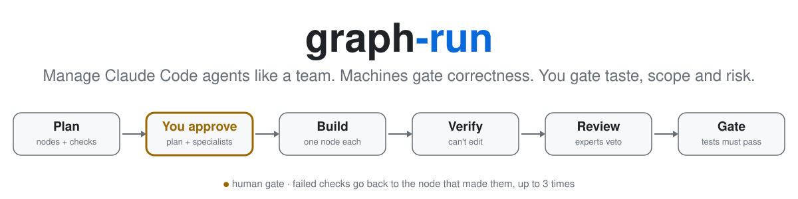
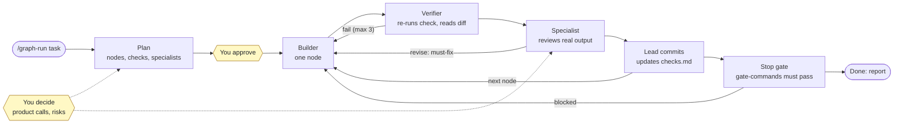
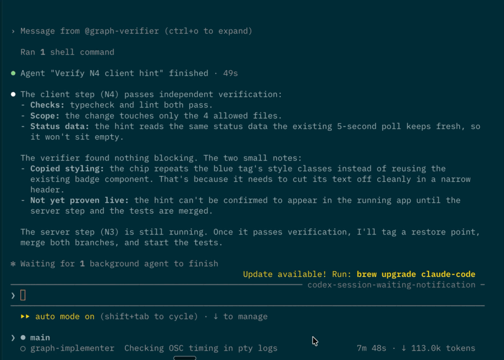
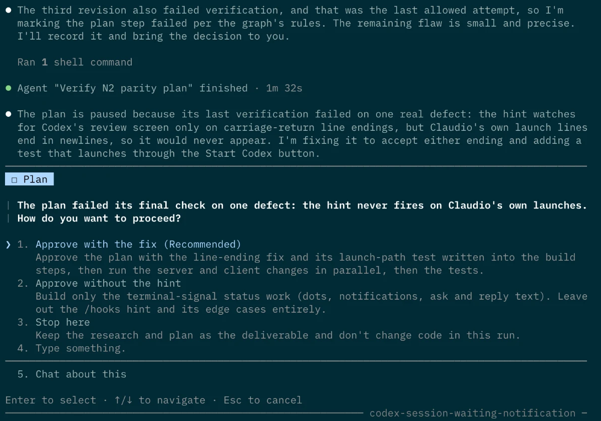

<p align="center">
  <picture>
    <source media="(prefers-color-scheme: dark)" srcset="assets/banner-dark.svg">
    
  </picture>
</p>

<p align="center">
  <a href="https://github.com/jeremywight/graph-run/actions/workflows/test.yml"></a>
  <a href="https://github.com/jeremywight/graph-run/releases"></a>
  <a href="LICENSE"></a>
  <a href="https://docs.claude.com/en/docs/claude-code/overview"></a>
</p>

# graph-run

**Manage Claude Code agents like a team: small jobs, an independent verifier, expert reviewers, a hard gate, and you at the gates.**

Most multi-agent setups fail the same way. One long session tries to do everything, the agent grades its own work, its memory is the chat, and the human either rubber-stamps or micromanages. **Agents don't just need more autonomy. They need the right level of management.**

It's a slash command, two agents, a Stop hook and a settings file. There's no framework, server or runtime, and you can read all of it in ten minutes.

> **Proof, not a demo.** Its first real run built [The Matchmaker](https://playthematchmaker.com), a live daily puzzle game: 18 planned nodes, the kit's two agents plus the specialists it proposed for that project (a puzzle master, an Austen expert, a UI designer, and later a game designer), 507 tests. The gate blocked the agent 40 times, and the owner made 16 logged decisions. [Read what happened](docs/case-study.md), failures included.

## Quickstart

```bash
git clone https://github.com/jeremywight/graph-run
./graph-run/install.sh /path/to/your-repo
```

Then, in Claude Code in that repo, describe the work:

```
/graph-run <what you want done>. Checks: <commands that must pass>. Scope: <files it may change>. Limit: <max nodes>.
```

For example:

```
/graph-run Add CSV export to the reports page. Checks: npm test passes; npx tsc --noEmit clean. Scope: src/reports/**, tests/reports/**. Limit: 8 nodes.
```

Only the description is required. Anything you leave out, it fills in from the repo and states as an assumption for you to correct at approval.

It plans the work, proposes the specialist reviewers your task needs, and **stops for your approval** before touching a source file.

<!-- GIFs go here once recorded:
<p align="center"></p>
-->

## Why it works

- **Small nodes.** One input, one output, one check per job.
- **The builder never grades its own work.** A separate verifier, which cannot edit files, re-runs the check and reads the diff for weakened or circular tests.
- **Specialists with a veto.** At planning, `/graph-run` lists the judgment your tests can't make (fairness, voice, design, security, motivation) and proposes an expert reviewer for each gap. You accept, drop or add. Their must-fix items go back to the node that caused them.
- **A hard gate.** A Stop hook won't let the lead finish while tests, typecheck or build fail.
- **Memory lives in files, not chat.** `graph.md`, `checks.md` and `progress.md` let any session pause and resume the run.
- **You are a gate, not a spectator.** Machines gate correctness. You gate taste, scope and risk.

## How a run works



1. **Plan.** Claude fills six inputs (task, deliverable, acceptance checks, sources, scope, run limit), writes `graph/graph.md` and `graph/checks.md`, proposes specialists, writes the command-style checks into `.claude/gate-commands`, and **stops for your approval**.
2. **Run.** It creates `graph/.active`, records a baseline, then runs nodes as subagents, in separate git worktrees when they run in parallel. Deterministic steps (merge, count, compare) are scripts, not model calls.
3. **Gate.** While `graph/.active` exists, the Stop hook runs `gate-commands`. Claude can't finish until they pass. After 3 blocked attempts it may stop, so it reports the failure instead of looping. Every attempt is logged in `graph/gate-log.md`.
4. **Learn.** Failed attempts and learned rules go into `graph.md`, the lead's own mistakes included.
5. **Pause or resume.** Pausing writes `graph/HANDOFF.md` plus a prompt per remaining step. In a new session, run `/graph-run resume`.

<p align="center"></p>
<p align="center"><em>One agent verifies a node, checking scope and results. Another builds the next node from a spec it isn't allowed to bend.</em></p>

## What you get

The kit installs five things into your repo: the `/graph-run` command, two agents that every run uses (`graph-implementer` builds one node; `graph-verifier` re-checks it and cannot edit), a Stop-hook gate, and a settings file.

> **You also get custom specialists, made for your task.** At planning, `/graph-run` reads your prompt and proposes the expert reviewers your task needs: the judgment your tests can't make, such as fairness, voice, design, security or domain correctness. **You approve each one before its agent file is written.** A puzzle game gets a puzzle master; an API gets a security reviewer; a contract tool gets a legal reviewer.

The kit includes templates to start specialists from (a domain reviewer, a security reviewer and a coordinator for outside agents) and [example specialists](templates/agents/examples/) from the case study. None of them are installed or used unless your run proposes them and you approve.

## Example from the case study

What a run produces: plain files you can read, diff and hand to the next session. **These excerpts are from the case study, a daily logic-puzzle game, so its specialists (here, a puzzle master) are the ones `/graph-run` proposed for that project.** Your run will propose its own. Lightly trimmed:

`graph/graph.md`: the plan, with an agent and a check for every node:

| id | type | agent | writes | check | depends on |
|---|---|---|---|---|---|
| N1 | model | puzzle-master *(specialist proposed for this project)* | `graph/reviews/01-engine-design.md` | rules on each clue type; states a human-solvability criterion the engine can test | none |
| N2 | model | graph-implementer *(from the kit)* | `src/engine/**`, `tests/engine/**` | `npx vitest run tests/engine` exits 0 (1,000 dates unique, deterministic, human-solvable) | N0, N1 |
| N5 | model | puzzle-master *(specialist proposed for this project)* | `graph/reviews/02-playtest.md` | solves 14 generated puzzles by hand before reading the answers; verdict `accept` | S1 |

`graph/checks.md`: one row per requirement, with evidence and no unproven "pass":

| node | requirement | verdict | evidence |
|---|---|---|---|
| N2 | 1,000 consecutive dates each have exactly one solution | pass | verifier: `npx vitest run tests/engine` 50/50 pass |
| N9 | 4 and 5 couples fit 390x844 without scrolling | fail (owner to decide) | five couples scroll the clue region only; the owner chose to judge on a phone |

`graph/gate-log.md`: the Stop gate's record:

```
- 2026-11-15 11:36:09 gate FAIL (attempt 1/3):
- npm test --silent (exit 1)
- 2026-11-15 11:49:12 gate PASS
```

## Where you sit

| Gate | When | Enforced by |
|---|---|---|
| Plan approval | After the graph is drawn, before any source file changes | The command stops; start in plan mode for a hard stop |
| Specialist roster | At plan approval, and whenever feedback shows judgment nobody is gating | The lead proposes; you accept, drop or add before any agent file is written |
| Product decisions | Whenever the inputs don't settle what the deliverable should do | The lead asks and logs your answer as `(owner)` |
| Reviewer escalations | Rulings marked "check", reviewer disagreements, a third `revise` | The command's `<human_gates>` and `<reviewers>` rules |
| Your feedback | After you try the build | Written to `graph/feedback/owner-<date>.md`, each item routed to a node |
| Exhausted retries | A node fails 3 times | The lead stops that branch and tells you; it doesn't fix it itself |
| Security risk acceptance | A finding you choose to accept rather than fix | Logged `(owner)` with the reason; the reviewer stops re-reporting it |
| Irreversible actions | Push, merge, reset, checkout, install, rm | `ask` rules in `settings.json` |
| Rules about the rules | An agent trying to loosen its own guardrails | `deny` on editing `settings.json` and `.claude/hooks/**` |

Everything else (does it build, do the tests pass, did the builder stay in scope, did anyone weaken a test) is checked by machines and the verifier, so your attention goes to judgment.

<p align="center"></p>
<p align="center"><em>Three failed verifications, then it stops and asks. From a second project, not the case study.</em></p>

## Specialists

The reviewers are what catch problems tests can't. In the case study, the puzzle master rejected the engine design before any code existed, and the game designer was added later because nobody was judging why a player would come back.

You don't have to write them up front: `/graph-run` proposes them. To start from something real, copy one of the [example specialists](templates/agents/examples/) from the case study (puzzle master, period expert, UI designer, game designer), or the blank [domain reviewer](templates/agents/domain-reviewer.md) and [security reviewer](templates/agents/security-reviewer.md) templates.

### Outside agents

Some work is better done outside Claude Code: in the case study, the owner preferred another vendor's agent for image generation over anything Claude could draw. `/graph-run` pairs such an outside agent with a Claude **coordinator** that briefs it, reviews its batches with the specialists and brings accepted work into the repo. The two never talk directly; they pass files and `READY-n` / `DONE-n` markers through a shared folder. Start from the [coordinator](templates/agents/coordinator.md) and [outside agent](templates/outside-agent.md) templates.

### Write back before closing

Agents defined only in a session's context, and protocols kept in a folder outside the repo, vanish when the session closes. So at the end of every phase, and before any session closes, the lead asks: *"What should we write back to our graph run?"* and records new agents, outside agents' setup, protocols, decisions and learned rules in `graph/`, so the whole team can be recreated later.

Built a good one? [Share it](https://github.com/jeremywight/graph-run/issues/new?template=share-a-specialist.md).

## Security: three layers, not one review

1. **Every stop: machine checks.** Dependency audit, secret scan, no tracked `.env` files, risky-sink searches, and tests that pin controls like security headers. See [`examples/gate-commands.security`](examples/gate-commands.security).
2. **New attack surface: design review.** A node that adds an endpoint, user input, stored personal data, auth, a third-party script, a secret or a permission is marked `surface`. The `security-reviewer` reviews its spec *before* it's built.
3. **Before deploy: release gate.** The `security-reviewer` reviews everything changed since the last security review, plus the system as it actually runs.

Accepting a risk is the owner's call, never the agent's.

## Install and update

The installer never overwrites anything. If your repo already has `.claude/settings.json`, it writes `.claude/settings.graph-run.json` for you to merge by hand, and it adds `graph/.active` and `graph/.gate_attempts` to `.gitignore`. Then:

1. **Fit `settings.json` to your stack.** The defaults assume Node with `src/` and `tests/`. Change the `Edit(...)` rules to your scope and swap in your test commands (`pytest`, `go test`, `cargo test`).
2. **Add security checks** from `examples/gate-commands.security` that fit your stack to `.claude/gate-commands`.

To update, pull the kit and run the installer with `--update` against each repo:

```bash
git -C graph-run pull
./graph-run/install.sh --update /path/to/your-repo
```

`--update` replaces only the kit's own files (the command, the two agents and the gate hook), backing up any it changes to `.claude/graph-run-backup/<time>/`. It never touches your `settings.json`, `gate-commands` or other agents. If you keep run files somewhere other than `graph/`, pass `--graph-dir .graph` (or your folder) on every install and update. Start a new Claude Code session afterwards so the new versions load.

## Writing a good run

A fuller example, with a deliverable and a time limit:

```
/graph-run Migrate src/api/* from callbacks to async/await.
Output: src/api + docs/migration/report.md.
Checks: npm test passes; npx tsc --noEmit clean; ! grep -rn "callback(" src/api.
Scope: src/api/**, tests/api/**. Limit: 12 nodes, 3 retries, 2h.
```

**Write checks a machine can run.** "The code is clean" can only be judged by a model, so its gate falls back to trusting the model. Turn taste into a specialist, and everything else into a command.

## What enforces what (and what doesn't)

| Rule | Enforcement | Strength |
|---|---|---|
| Approve before work | The command stops; plan mode optional | Medium (strong with plan mode) |
| Checks pass before finishing | `gate.sh` on the Stop hook (exit 2 blocks) | Strong |
| Don't weaken the gates | Deny edits to `settings.json` and `hooks/**`; verifier reads test diffs | Partial: `gate-commands` is editable, so review its diff |
| Stay in scope | Out-of-scope edits prompt for permission; verifier lists out-of-scope files | Medium: lost under auto-accept or skip-permissions |
| Push, merge, reset, install, rm | `ask` rules | Strong |
| No publish, curl or wget; no reading `.env` | `deny` rules | Strong |
| Verifier doesn't edit | No Edit or Write tools | Medium: Bash could still write |
| No two nodes on one file | Worktrees, by instruction | Weak: not hard-enforced |

Rows marked Weak, Partial or Medium rely partly or wholly on the prompt, and an agent can ignore a prompt. If a rule matters to you, back it with a permission rule or a hook, or check it yourself in review.

## FAQ

**When should I use it?** For work with three or more separable parts, work that won't fit in one context window, or work that has to survive a pause. For a single bug fix, plan mode plus "run the tests before you finish" is cheaper.

**What does it cost?** More tokens than one session: every subagent starts with a fresh context, and reviews run in rounds. Long runs can hit your plan's usage limits, so every agent saves as it goes and cut-off agents are resumed, not restarted. The trade is work you can trust and resume.

**Is it a framework?** No. It's Markdown instructions, two agent definitions, a bash hook and Claude Code settings. Nothing to run or host.

**Does it need git?** Yes. It uses git for baselines, worktrees for parallel nodes, and commits for recovery.

**Does it work with my stack?** The pattern is language-agnostic. Change the allow rules in `settings.json` and the commands in `gate-commands`.

## Known limits

- The gate runs on the lead's Stop, not on each subagent's. While parallel nodes are half-done, repo-wide tests can fail; per-node checks are run by the implementer and verifier instead.
- Agents added during a session may not load until the session restarts. The lead falls back to a general-purpose agent told to adopt the agent file.

## What's in the kit

```
.claude/commands/graph-run.md          the /graph-run command (the lead's operating manual)
.claude/agents/graph-implementer.md    builds one node; edits only allowed paths
.claude/agents/graph-verifier.md       re-runs a node's check; no Edit/Write tools; looks for weakened tests
.claude/hooks/gate.sh                  Stop-hook gate with a 3-attempt cap
.claude/gate-commands                  acceptance checks, one shell command per line
.claude/settings.json                  allow / ask / deny permissions and hook wiring
templates/agents/                      domain reviewer, security reviewer and coordinator templates
templates/agents/examples/             four specialists from a real run
templates/outside-agent.md             setup for an agent outside Claude Code (e.g. image generation)
templates/owner-feedback.md            how your feedback becomes routed work
templates/step-prompt.md               one prompt per remaining step, for handoffs
examples/gate-commands.security        sample security checks for the Stop gate
install.sh                             installer (--update, --graph-dir)
tests/test-gate.sh                     tests for the gate and installer
docs/case-study.md                     a real run, failures included
```

## Credits

Built by Jeremy Wight, with Claude. It started from the "graph of bounded nodes" prompt pattern shared online (which draws on Andrej Karpathy's autoresearch ideas). I cleaned that prompt up, backed its rules with Claude Code permissions and hooks, and added the verifier, specialists, human gates and handoff practice after running it on a real project, all run from a phone, coordinating remote-controlled agents back on the laptop.

## License

MIT. See [LICENSE](LICENSE).
